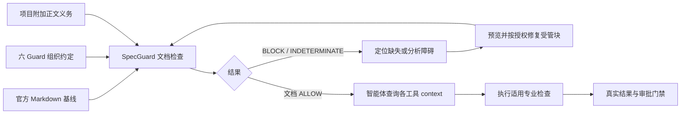

# AGENTS.md 上下文规范检查

SpecGuard 0.2.0 检查明确指定目录是否有 AGENTS.md、是否包含六个 Guard 的完整指引，以及项目额外约定。

## 官方规范与组织约定

[AGENTS.md 官方说明](https://agents.md/)（2026-10-16 核对）定义普通 Markdown，没有强制字段或标题。项目概览、构建测试、安全等是推荐内容，不应标成官方必填字段。

`six-guard-context/v1` 是本项目的组织 profile：要求根文档存在，并包含六个唯一、闭合、不嵌套的受管块。每块必须有共享安装库生成的五条正文：触发、入口、规则、失败处理、证据。每个工具何时运行各不相同，具体规则仍查询当前项目 context，不将固定 GitFlow 或 Java/DDD4j 要求套给所有项目。



## CLI 与 MCP

```powershell
specguard agents check --project E:/workspaces/my-project
specguard agents template --project E:/workspaces/my-project
```

两个命令返回 JSON。template 的 content 是 Markdown 审阅稿；没有写文件、安装工具或覆盖人工内容。短命令要求二进制在 PATH，否则用构建产物的完整路径。

MCP `specguard_check_agents` 和 `specguard_agents_template` 只接受 `project` 绝对目录，使用与 CLI 相同的实现。报告包括 finding 路径/行号、规则编号、来源（organization / project / analyzer）、修复建议、AGENTS.md 与策略 SHA256。根文档缺失 finding 没有行号；缺少内容定位到对应块开始行。

| 退出码 | 结果 | 含义 |
|---|---|---|
| 0 | ALLOW | 指定根文档满足当前组织及项目字面约定 |
| 2 | BLOCK | 文件、受管块或必需内容缺失/重复/配对错误 |
| 3 | INDETERMINATE | 策略无效、读取失败、未知版本、链接、乱码或超限 |
| 4 | 参数错误 | 命令或路径参数无效 |

这是独立的文档检查报告（schema_version=1），不是 Guard Protocol 的交付授权报告。execution_status 和 approval_status 始终为 not_evaluated。源码变化后直接重新 check；不信任先前检查的缓存。摘要用于对照输入，不是签名，读文件期间的并发修改也不构成原子快照。

## 项目自定义约定

在项目的 `.specguard/agents-policy.json` 添加字面义务；只扩展，不禁用六工具约定：

```json
{
  "schema_version": 1,
  "required_text": [
    {"id": "single-spec-source", "text": "同一变更只保留一个规格事实源。"},
    {"id": "preserve-user-work", "text": "不得覆盖用户未提交的修改。"}
  ]
}
```

未知字段/版本、重复 ID、空义务不接受；最多 128 项，每项 text 最多 4096 字节。默认义务用固定字面比较，附加 text 在可见正文中匹配。任意改写为同义句不能自动视为等价；自然语言冲突需要审查。政策文件不代表批准来源，可信 CI 需要独立保护其版本。

## 修复和旧版提示迁移

旧版提示仍可由智能体读取，但不一定满足新组织 profile。用各工具新版 `instructions render --project PROJECT` 查看完整指引；已安装的受管块使用 `instructions sync --project PROJECT --dry-run` 预览，然后在授权范围内同步。新增安装使用既有 install 机制。共享安装器只维护本工具块，保留人工内容；有人工编辑冲突时不会强制覆盖。

不用 SpecGuard 创建第二套写入器，不通过删回执、重置配置消除冲突。修复后重新 check，并检查摘要与当前文档一致。生成六块不意味着六个程序已经可运行，后续必须查询实际能力和执行结果。

## 覆盖范围

只检查显式 --project 的根 AGENTS.md 和附加策略。不会递归扫描、自动合并父级/子级指令，或检查 AGENTS.override.md、全局配置、宿主截断和实际加载；需要检查子项目时指定子项目目录，并另行核对继承关系。文件每个最多 1 MiB；UTF-8、拒绝链接/reparse point 是本分析器边界，并非 AGENTS.md 官方禁令。

代码块、引用、HTML 注释中的示例不作为指令正文。检查不执行文档命令、不判断任意全文语义，不证明智能体遵循文档。强制门禁需要 CI/Harness 真实调用各检查并核验覆盖和授权。

插件包：[plugin](../plugin/README.md)。正式增量规格位于同级 GuardEngine 的 `openspec/changes/add-agents-context-governance`。
