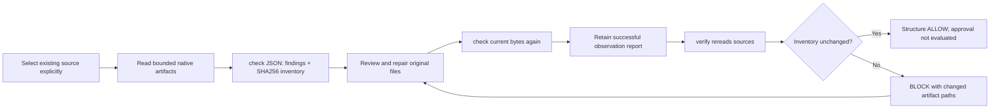

# Native specification checks and repeatable verification

This implementation follows the existing architecture and technical design, under the cross-repository source of truth [professional-guard-checks](../../guardengine/openspec/changes/professional-guard-checks/). No SpecGuard OpenSpec/Spec Kit initialization or duplicate specification was created.

Implemented commands (absolute paths required):

```sh
specguard specs check --project /absolute/project --source openspec
specguard specs check --project /absolute/project --source speckit
specguard specs verify --project /absolute/project --source openspec --baseline /absolute/project/.specguard/native-check.json
```

`check` and `verify` only return JSON and never write project files or execute document instructions. Save the successful check JSON as UTF-8 **outside** `openspec/`, `.specify/`, and `specs/`. For PowerShell 7, use `| Set-Content -Encoding utf8NoBOM PATH`. The caller owns saving and retaining evidence. Neither command overwrites a report, accepts changed criteria, grants approval, installs tools, initializes a framework, switches branches, or runs implementation tests.



## Supported native structures

| Source | Parsed native requirements | Checks and limitations |
|---|---|---|
| OpenSpec | `openspec/specs/CAPABILITY/spec.md`, `openspec/changes/CHANGE/specs/CAPABILITY/spec.md` | Real CommonMark `### Requirement: NAME` headings; duplicate names within an artifact; each defined requirement has a `#### Scenario: NAME` with visible WHEN/THEN clauses. `## REMOVED Requirements` has no new-scenario obligation. Renamed-only or unknown formats are incomplete. |
| Spec Kit | `specs/**/spec.md`, with `.specify/` present | Native `FR-NNN: statement` text, including bold IDs in list items; duplicate IDs within one feature; empty statements. No imposed cross-feature ID uniqueness. No inference from task checkboxes. |

Fenced/indented examples, block quotes, images and comments cannot supply native requirements/scenarios. Different capability artifacts, baseline specs and delta specs can legitimately repeat the same requirement name. Explicit `--source` prevents accidental framework selection when both systems exist; it does not itself establish which specification is authoritative.

The digest inventory includes **every file** under the selected `openspec/` or `.specify/` plus `specs/`, including proposal, plan, design, tasks and configuration. `openspec/changes/archive/` is explicitly excluded historical content. Templates are inventoried but are not interpreted as native requirement artifacts. Changes to plans/tasks without changing requirement headings still invalidate the observed inventory. Missing source roots, missing supported requirements, invalid UTF-8 in spec files, read errors or resource limits return INDETERMINATE rather than ALLOW.

The checker rejects source symlinks and Windows reparse points, non-regular files, more than 512 entries/files, directory depth beyond 12, files above 1 MiB, or total bytes above 16 MiB. It does not provide an operating-system sandbox or an atomic filesystem snapshot; use an immutable checkout for trusted CI rechecks.

## Reports and baseline trust

Reports use `schema=specguard-native/v1`, `analyzer=native-structure/1`. Stable ordered inventories make repeated check/verify deterministic for identical bytes. Each source has a relative path and SHA256; requirement findings include original file and line. No full business document text is copied into the report.

`verify` accepts a successful report for the same canonical project path and source. Invalid JSON, wrong project/source/schema, a non-successful report, or malformed source hashes are baseline argument errors. It rereads and rechecks current artifacts, then reports `baseline_drift` on each added, removed or modified path. Failed or partial current analysis still cannot pass. Return codes: 0 structural ALLOW, 2 structural issue/drift, 3 incomplete analysis, 4 argument/baseline error.

The snapshot is **an untrusted observation**, editable by its owner. It is not a signed receipt, protected contract or approved revision; rebuilding or tampering with it can hide observation drift. `approval_status` and `execution_status` remain `not_evaluated`, and `baseline_trust` is `untrusted_observation`. Use protected CI sources and an external approval authority for production authorization. Exact-byte drift does not classify semantic weakening or prove a requirement has been implemented. Native adapters, task/test trace graphs, review authority, signed baselines, business correctness and runtime evidence remain separate work.

## MCP and plugin

`specguard_check_specs({project, source})` and `specguard_verify_specs({project, source, baseline})` use the same CLI analyzer. Extra arguments, relative directories and unsupported sources are rejected. The portable plugin includes `specguard-native-specs` for check → review/repair → recheck → verify; host loading and binary installation remain separately verifiable.
